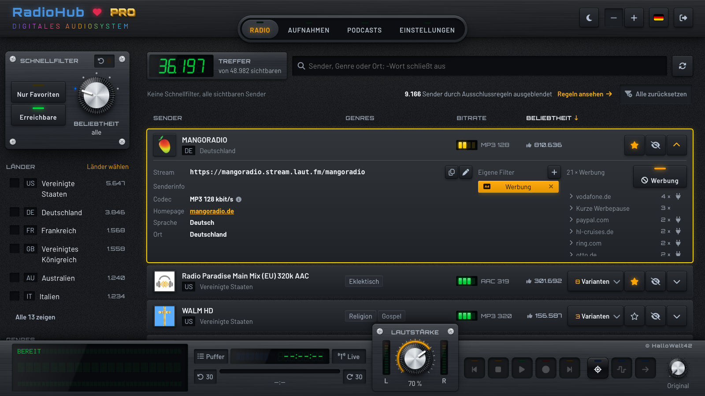
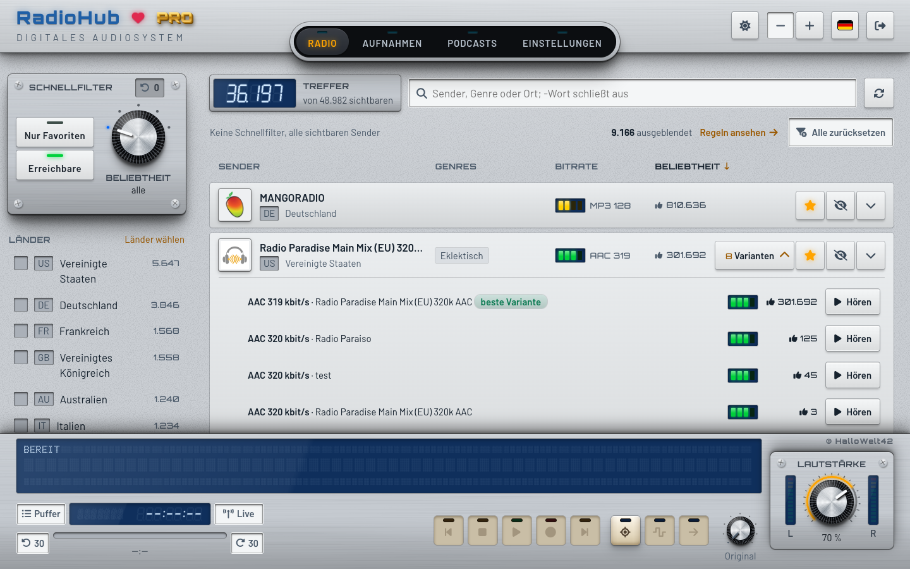
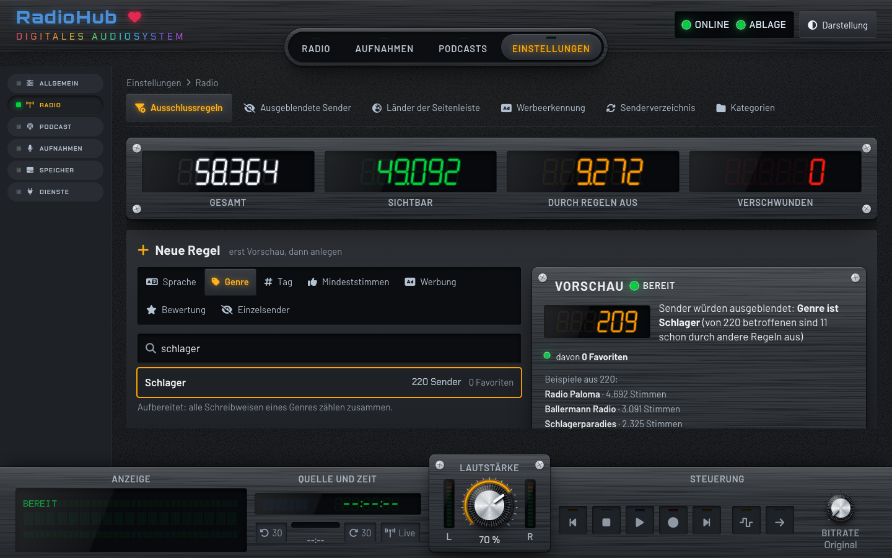
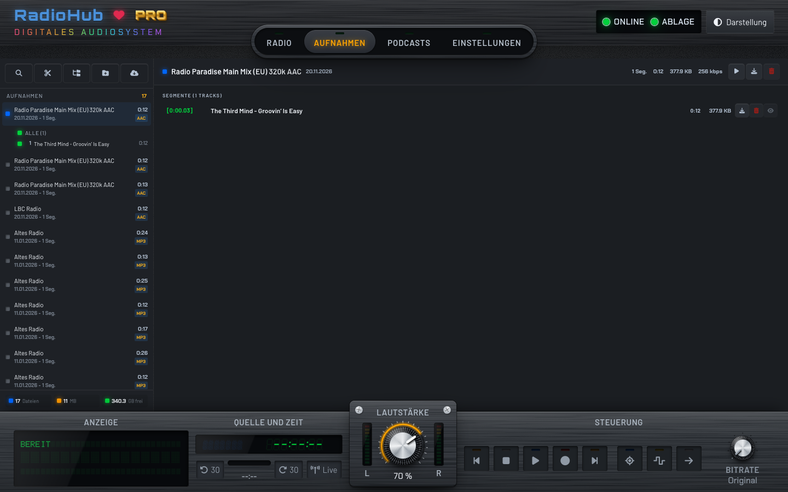
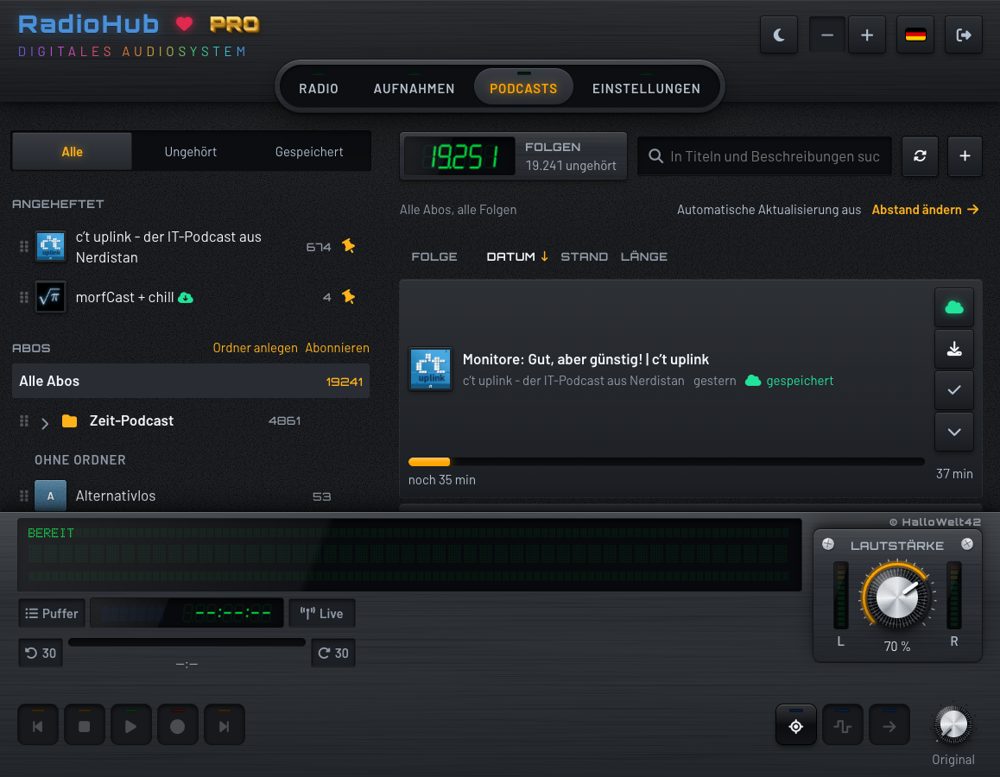
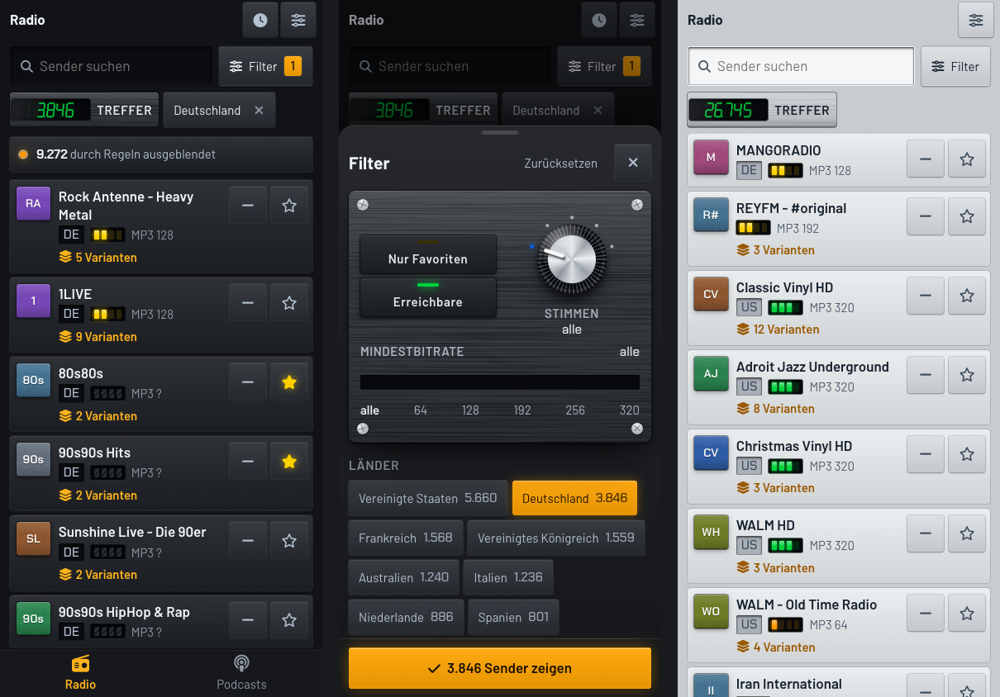
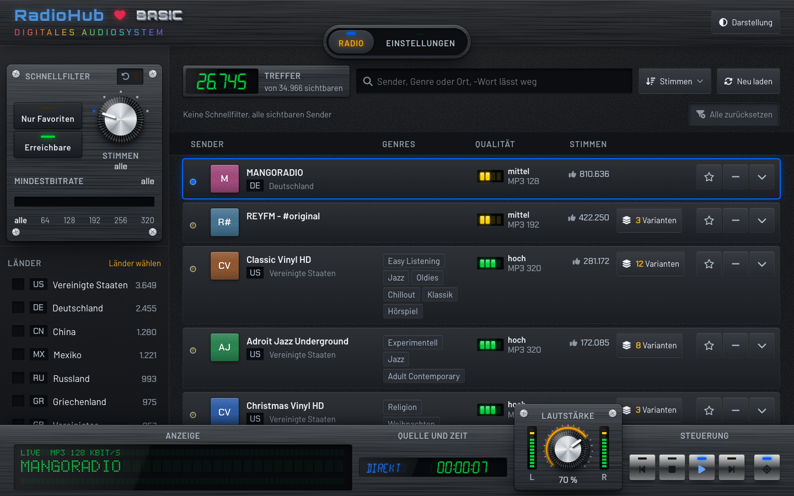

# RadioHub - Digital Audio System

Internetradio, Podcasts und Aufnahmen in der Optik einer HiFi-Anlage, in zwei Ausgaben:

- **RadioHub PRO**: die volle Version mit Frontend und Backend, gedacht für einen Raspberry Pi im Heimnetz. Dieses
  Repo ist ihr Quellcode.
- **RadioHub Basic**: nur das Radio, ohne Backend, direkt im Browser:
  [hallowelt42.github.io/RadioHub](https://hallowelt42.github.io/RadioHub/)



## Funktionen

- **Radio:** über 50.000 Sender, nachts abgeglichen; Sprachen, Genres, Qualität und Dubletten aufbereitet
- **Filtern:** Schnellfilter in der Seitenleiste, Suche mit Minus (`jazz -werbung`), Minus an jedem Sender
- **Ausschlussregeln:** wirken auch auf neue Sender; erst Vorschau, dann anlegen
- **Abspielleiste:** Punktmatrix, Zeitversatz, Lautstärke, Steuerung in einer Tastenreihe
- **Aufnahmen und Podcasts:** mitschneiden und schneiden, Abos mit Folgen
- **Telefon:** eigene Oberfläche, quer als Wecker für den Nachttisch
- **Darstellung:** HiFi oder Klassisch, hell, dunkel oder nach dem System, Schrift bis sehr groß, 20 Sprachen

| | |
|---|---|
|  |  |
|  |  |



## RadioHub Basic

Dieselbe Bedienung wie in PRO für das Radio; Favoriten, Regeln und Sperren bleiben im Browser und lassen sich als Datei
sichern. Ohne Zeitversatz, Aufnahmen, Podcasts und Senderlogos. Beim Blättern lädt die Seite nichts von fremden
Servern; erst beim Abspielen holt der Browser den Strom beim Sender.



## Starten

```bash
git clone https://github.com/HalloWelt42/RadioHub.git
cd RadioHub
docker compose up -d --build        # PRO unter https://<Rechner>:9093
```

Zum Entwickeln:

```bash
./einrichten.sh                      # Python-Umgebung, Pakete, Git-Haken
cd frontend && npm run dev           # PRO (Backend auf 9091 starten, siehe Betrieb)
cd frontend && npm run dev:web       # Basic unter http://localhost:5190/RadioHub/
```

Einrichtung, Betrieb auf dem Pi, Ablage, Wecker und alle Einstellungen: [docs/BETRIEB.md](docs/BETRIEB.md).
Aufbau und Regeln: [docs/ARCHITEKTUR.md](docs/ARCHITEKTUR.md).

---

## Lizenz

**Nicht-kommerzielle Nutzung** - Siehe [LICENSE](LICENSE)

Erlaubt: Private Nutzung, Installation, persönliche Anpassungen, Teilen mit Quellenangabe

Verboten: Kommerzielle Nutzung, Verkauf, Einbindung in kommerzielle Produkte

---

## Unterstützen

RadioHub ist ein privates Hobby-Projekt. Kein Tracking, keine Werbung, keine Kompromisse.

Wenn dir das Projekt gefällt, kannst du ihm einen Stern auf GitHub geben - oder direkt hier:

[](https://ko-fi.com/HalloWelt42)

**Crypto:**

| Coin | Adresse |
|------|---------|
| BTC | `bc1qnd599khdkv3v3npmj9ufxzf6h4fzanny2acwqr` |
| DOGE | `DL7tuiYCqm3xQjMDXChdxeQxqUGMACn1ZV` |
| ETH | `0x8A28fc47bFFFA03C8f685fa0836E2dBe1CA14F27` |

Copyright (c) 2025-2026 HalloWelt42
