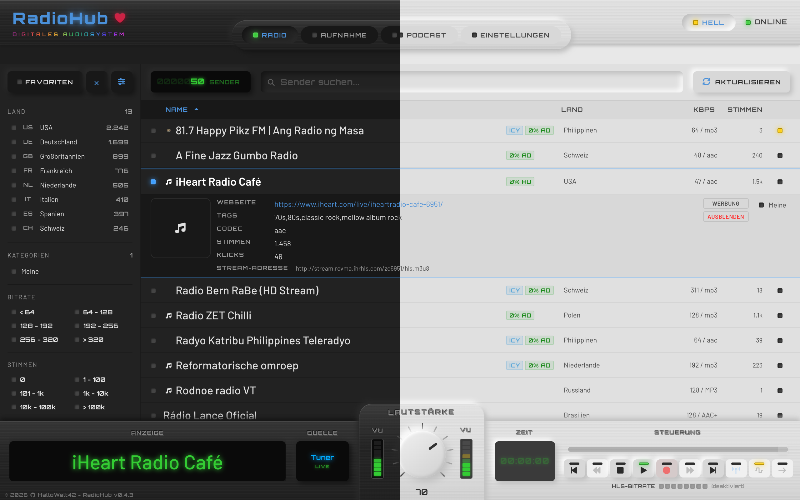
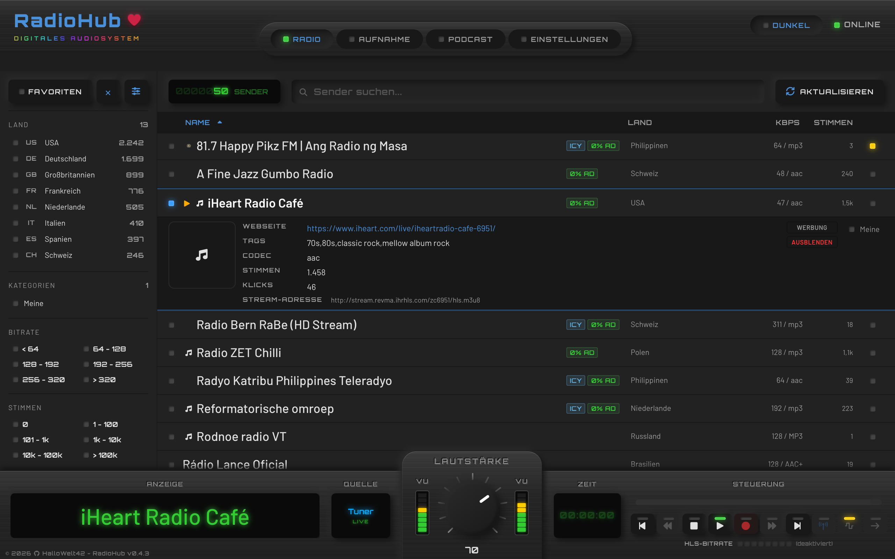
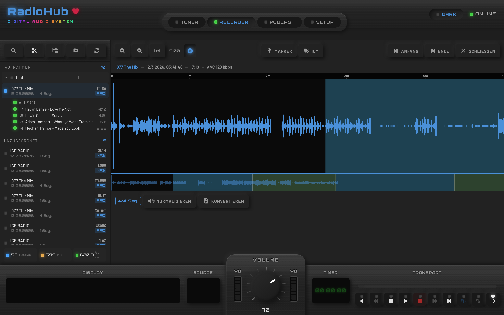
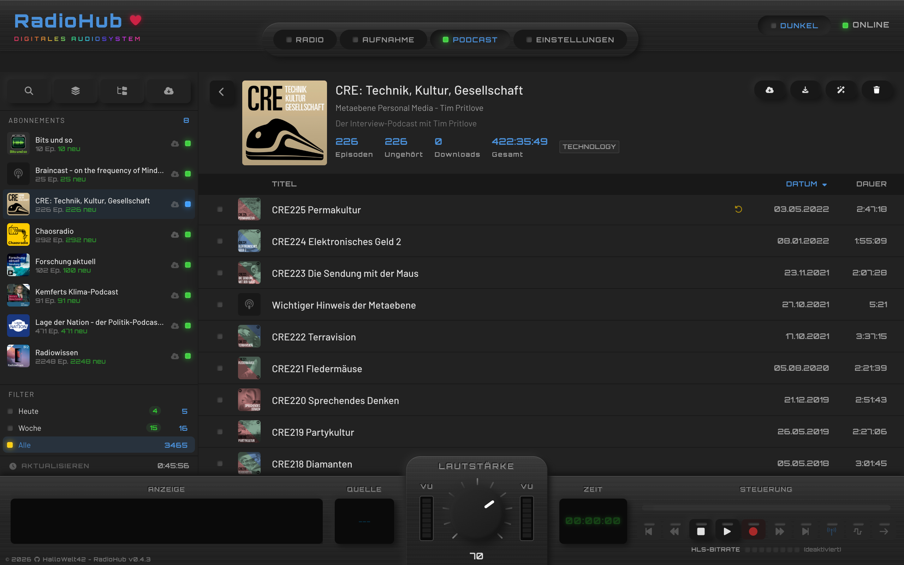
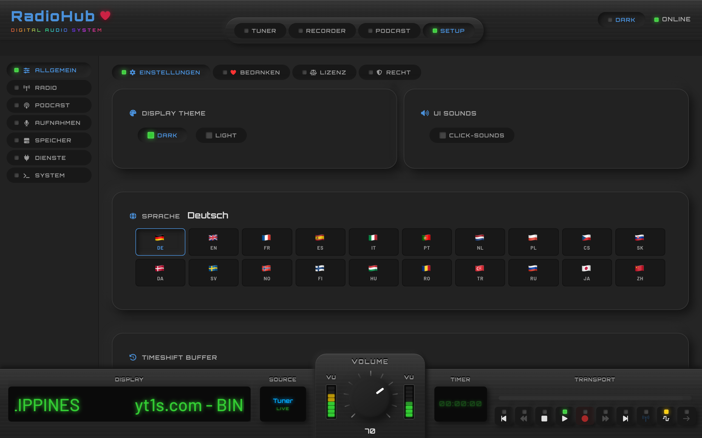
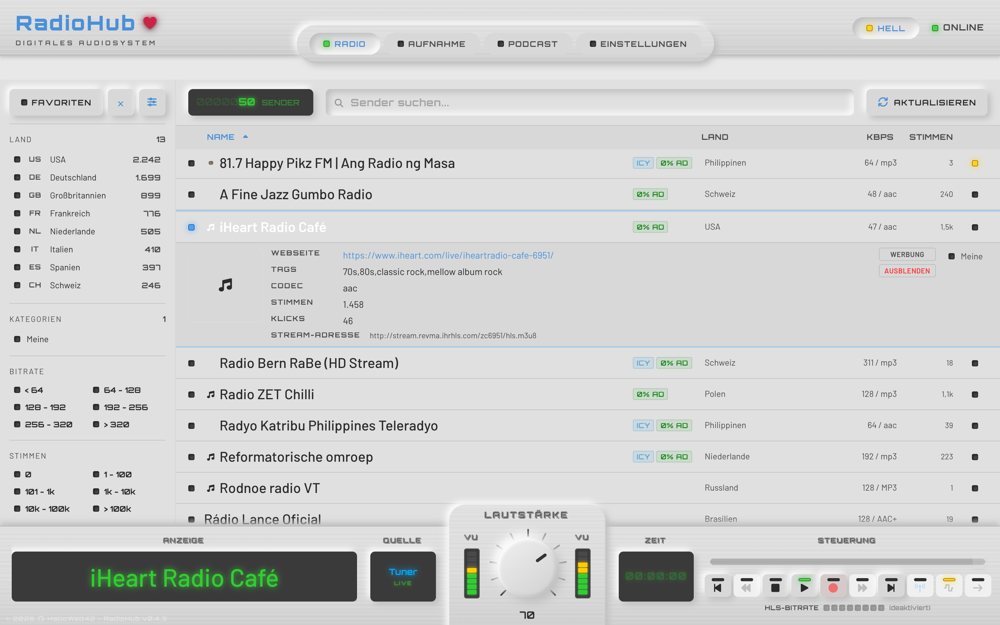

# RadioHub - Digital Audio System

Webbasiertes Internetradio, Podcast-Player und Audiorecorder mit HiFi-Optik.
Konzipiert für Raspberry Pi, läuft aber auf jedem System mit Python und Node.js.



---

## Features

### Tuner - Internetradio

Zugriff auf tausende Sender weltweit über die Radio-Browser-API.
Filterbar nach Land, Bitrate, Codec und Votes. Favoritenverwaltung inklusive.



- Sendersuche mit Echtzeit-Filter und Sortierung
- Länderliste mit Senderanzahl
- Favoritensystem mit Drag-and-Drop-Sortierung
- Sender-Details: Homepage, Codec, Bitrate, Stream-URL
- Favicon-Caching für schnelle Darstellung
- Laufschrift mit aktuellem Titel (ICY-Metadata)

### Recorder - Aufnahmen

Laufende Streams mitschneiden, segmentieren und bearbeiten.
Integrierter Waveform-Cutter für präzises Schneiden.



- Zeitgesteuerte und manuelle Aufnahme
- Waveform-basierter Audio-Cutter mit Minimap
- Segment-Schnitt per Doppelklick oder Tastatur
- Normalisierung (LUFS) und Format-Konvertierung (MP3, FLAC, OGG, WAV)
- Datei-Explorer mit Sortierung und Segment-Selektion

### Podcasts

RSS-Feeds abonnieren, Episoden streamen oder herunterladen.



- Podcast-Suche und Abonnement-Verwaltung
- Episoden-Filter: Alle, Ungehört, Downloads
- Streaming und Offline-Downloads
- Automatische Feed-Aktualisierung

### Setup

Umfangreiche Einstellungen für Darstellung, Sprache und System.



- Dark Mode und Light Mode
- 20+ Sprachen mit Flaggen-Auswahl
- Aufnahme-Einstellungen (Format, Qualität, Speicherpfad)
- Timeshift-Buffer-Konfiguration
- System-Informationen und Dienste-Verwaltung

### HiFi-Player

Der Player orientiert sich an klassischer HiFi-Geräte-Optik:

- Gebürstetes Edelstahl-Design (Brushed Metal)
- VU-Meter mit Echtzeit-Pegelanzeige
- Transport-Buttons im Hardware-Look
- Drehregler für Lautstärke
- LED-Anzeigen für Status und Navigation
- Laufschrift-Display mit Stream-Titel
- Tastatursteuerung (Space, Pfeiltasten, 1-4 für Tabs)

### Light Mode

Alle Oberflächen sind auch im hellen Design verfügbar.



---

## Technik

| Komponente | Technologie |
|------------|-------------|
| Frontend | Svelte 5 (Runes), Vite, hls.js |
| Backend | Python, FastAPI, FFmpeg |
| Audio | HLS-Streaming, ICY-Metadata, LUFS-Normalisierung |
| Datenbank | SQLite |
| Icons | Font Awesome 6 |
| Fonts | Orbitron (Logo), Barlow (UI) |

### Architektur

```
radiohub-frontend/    Svelte 5 SPA (Port 5180)
radiohub-backend/     FastAPI REST-API (Port 9091)
  backend/
    ablage/           Ablage der Dateien (Schnittstelle, Kellerwolke, Testablage, Ordnerstruktur)
    routers/          API-Endpunkte
    services/         Business-Logik, Audio-Verarbeitung
    database.py       SQLite-Anbindung
  tests/              Prüfungen des Backends (pytest)
```

### Installation per Docker (empfohlen, Pi und Mac)

Voraussetzung: Docker mit Compose-Plugin.

```bash
git clone git@github.com:HalloWelt42/RadioHub.git
cd RadioHub
docker compose up -d
```

Aufruf:

- App: `http://localhost:9092` (bzw. `http://<host-ip>:9092` im LAN)
- Backend-API direkt: `http://localhost:9091`
- API-Docs: `http://localhost:9092/docs`

Datenbank, Cache und Zwischenstände liegen in `./data` neben dem Repo; Aufnahmen und heruntergeladene
Podcast-Folgen liegen in der Kellerwolke (siehe "Ablage in der Kellerwolke").

Updates:

```bash
git pull
docker compose up -d --build
```

### Ablage in der Kellerwolke

Jede Datei des RadioHub liegt in der Kellerwolke unter `Apps/RadioHub`: Aufnahmen (von Hand und
zeitgesteuert), ihre Stücke nach dem Schnitt, Titellisten, Wellenformen und heruntergeladene Podcast-Folgen.
Lokal hält das RadioHub nur Zwischenstände im Arbeitsordner (`data/cache/arbeit`): die laufende Aufnahme,
einen laufenden Download und die Arbeitskopie zum Schneiden. Danach geht alles in die Kellerwolke und lokal weg.
Favoriten, Abos und gemerkte Folgen bleiben in der Datenbank des RadioHub.

Ordnerstruktur in der Kellerwolke:

```
Apps/RadioHub/
  Aufnahmen/<Sender>/<JJJJ-MM-TT HH-MM-SS>/001 <Titel>.mp3     Stücke einer Aufnahme
  Aufnahmen/<Sender>/<JJJJ-MM-TT HH-MM-SS>/Titelliste.json     Titelwechsel und Ereignisse
  Aufnahmen/<Sender>/<JJJJ-MM-TT HH-MM-SS>/Wellenform.peaks    Wellenform für den Schnitt
  Aufnahmen/<Aufnahmeordner>/<Sender>/<JJJJ-MM-TT HH-MM-SS>/   Aufnahme in einem eigenen Ordner
  Podcasts/<Abo>/<JJJJ-MM-TT> <Folge>.mp3                      heruntergeladene Folge
```

So arbeiten die Funktionen mit der Ablage:

- Wiedergabe von Stücken und Folgen läuft über das Backend aus der Kellerwolke, mit Bereichsanfragen (Spulen)
- Schneiden, Normalisieren und Umwandeln arbeiten an einer lokalen Arbeitskopie; gleicher Dateiname wird eine
  neue Version in der Kellerwolke, ein anderes Format eine neue Datei (die alte geht in den Papierkorb)
- Löschen legt in den Papierkorb der Kellerwolke (wiederherstellbar)
- Ist die Kellerwolke beim Ablegen nicht erreichbar, wartet das RadioHub (`RADIOHUB_KELLERWOLKE_GEDULD_S`); was dann
  noch fehlt, bleibt im Arbeitsordner und wird beim nächsten Start nachgeholt

Einrichtung (einmal je Rechner):

1. App-Schlüssel auf dem Rechner der Kellerwolke anlegen; er geht nur in eine Datei mit den Rechten 600:

   ```bash
   cd <Ordner der Kellerwolke>
   backend/.venv/bin/python tools/app_zugang.py --konto <Konto> --app RadioHub \
     --datei <RadioHub>/data/kellerwolke.schluessel
   ```

2. Zertifikatsstelle der Hausstelle als `zertifikate/rootCA.pem` neben `docker-compose.yml` ablegen
   (nur nötig, wenn die Kellerwolke über HTTPS mit eigenem Zertifikat erreichbar ist)
3. `.env` neben `docker-compose.yml` anlegen:

   ```bash
   RADIOHUB_KELLERWOLKE_ADRESSE=https://<Rechner der Kellerwolke>:<Port>
   RADIOHUB_KELLERWOLKE_CA=/zertifikate/rootCA.pem
   ```

4. `docker compose up -d --build`; das Backend meldet beim Start `Ablage: Verbunden als App RadioHub ...`,
   den Stand zeigt auch `GET /api/storage/ablage`

Einstellungen (Umgebung, in Docker über `.env`):

| Variable | Bedeutung | Vorgabe |
|----------|-----------|---------|
| `RADIOHUB_KELLERWOLKE_ADRESSE` | Adresse der Kellerwolke | leer (dann keine Ablage, Dateiarbeit meldet das) |
| `RADIOHUB_KELLERWOLKE_SCHLUESSEL` | Pfad der Schlüsseldatei (nie der Schlüssel selbst) | `/data/kellerwolke.schluessel` |
| `RADIOHUB_KELLERWOLKE_WURZEL` | Wurzelordner in der Kellerwolke | `Apps/RadioHub` |
| `RADIOHUB_KELLERWOLKE_CA` | Zertifikatsstelle (PEM) | leer (nur die üblichen Stellen) |
| `RADIOHUB_KELLERWOLKE_GEDULD_S` | Wartezeit beim Ablegen, wenn die Kellerwolke fehlt | `900` |

Prüfungen des Backends (mit einer Testablage im Speicher, nie mit echten Daten):

```bash
cd radiohub-backend
pip install -r requirements-test.txt
python -m pytest
```

Mit `RADIOHUB_PROBE_KELLERWOLKE=1` und den Einstellungen oben laufen die Prüfungen der Ablage zusätzlich gegen
eine echte Kellerwolke, in einem eigenen Probeordner unter dem Wurzelordner, der danach in den Papierkorb geht.

### Lokale Entwicklung (ohne Docker)

Voraussetzungen: Python 3.11+, Node.js 18+, FFmpeg.

```bash
# Backend
cd radiohub-backend
python -m venv .venv
source .venv/bin/activate
pip install -r requirements.txt

# Frontend
cd ../radiohub-frontend
npm install
```

Starten:

```bash
# Backend (Port 9091)
cd radiohub-backend
source .venv/bin/activate
uvicorn backend.main:app --host 0.0.0.0 --port 9091 --reload

# Frontend Dev-Server (Port 5180, mit Vite-Proxy auf 9091)
cd radiohub-frontend
npm run dev
```

Die App ist im Dev-Modus unter `http://localhost:5180` erreichbar.

---

## Lizenz

Nicht-kommerzielle Lizenz v1.0 (`LicenseRef-RadioHub-NC-1.0`)
Basierend auf [CC BY-NC-ND 4.0](https://creativecommons.org/licenses/by-nc-nd/4.0/legalcode.de) mit Ergänzungen.

Copyright 2025-2026 HalloWelt42

Private, nicht-kommerzielle Nutzung und private Modifikation erlaubt.
Kommerzielle Nutzung, Verkauf und Veröffentlichung modifizierter Versionen untersagt.
Vollständige Lizenzbedingungen: [lizenz.md](radiohub-frontend/public/legal/de/lizenz.md)
